# Aurora UI — Templates

**Ten complete design languages for Roblox, built on one component library.**
Same API, same widgets, same demo script — swap one line and the whole menu
changes its palette, radius, borders, card treatment, button treatment, tab
geometry and typography.

[](LICENSE)
[](https://luau.org)
[](https://rojo.space)
[](CHANGELOG.md)
[](https://lorenzz20105-del.github.io/aurora-ui-templates/)
[](.github/workflows/tests.yml)

### ▶ **[Open the live preview — all ten templates, rendered from the real Luau](https://lorenzz20105-del.github.io/aurora-ui-templates/)**

*(offline copy: [`docs/index.html`](docs/index.html) — one self-contained file)*

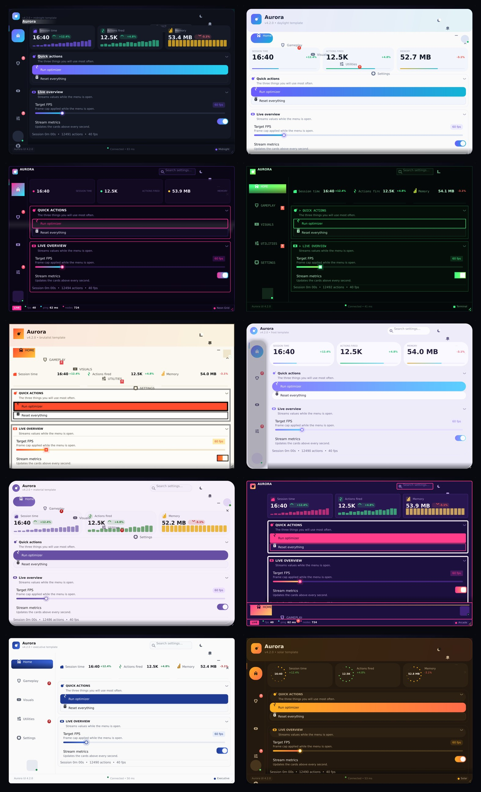

Every window in this repo is a screenshot of **the Luau itself**. `tools/dump.py`
runs the real `CreateWindow(...)` call and the real demo inside a headless Roblox
mock, and `tools/engine.js` lays the captured instance tree out in HTML. No
mock-ups, no hand-drawn approximations — if a border is 2 px in the picture, it is
2 px because `Styles.luau` says so.

```lua
local UI = require(game.ReplicatedStorage.UI.UILibrary)

local window = UI.CreateWindow({
    Title = "Aurora",
    Style = "Neon Grid",   -- ← the only line that changes
})
```

---

## The ten templates

| | | |
| --- | --- | --- |
| 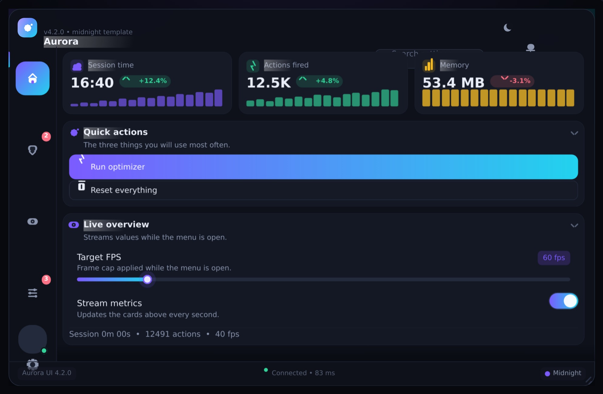 | 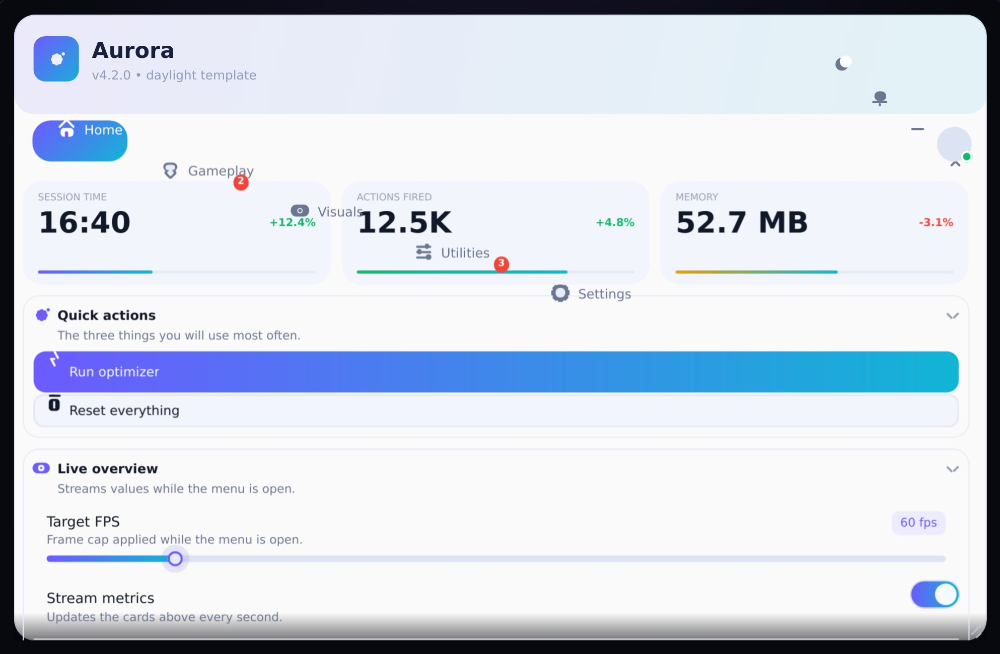 | 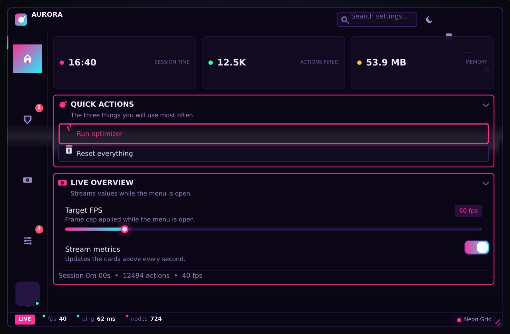 |
| **Midnight** · `midnight`<br>Glass panels, indigo→cyan gradient, icon rail | **Daylight** · `daylight`<br>Bright surfaces, hairline cards, friendly | **Neon Grid** · `neon`<br>Cyberpunk: outline cards, magenta glow |
| 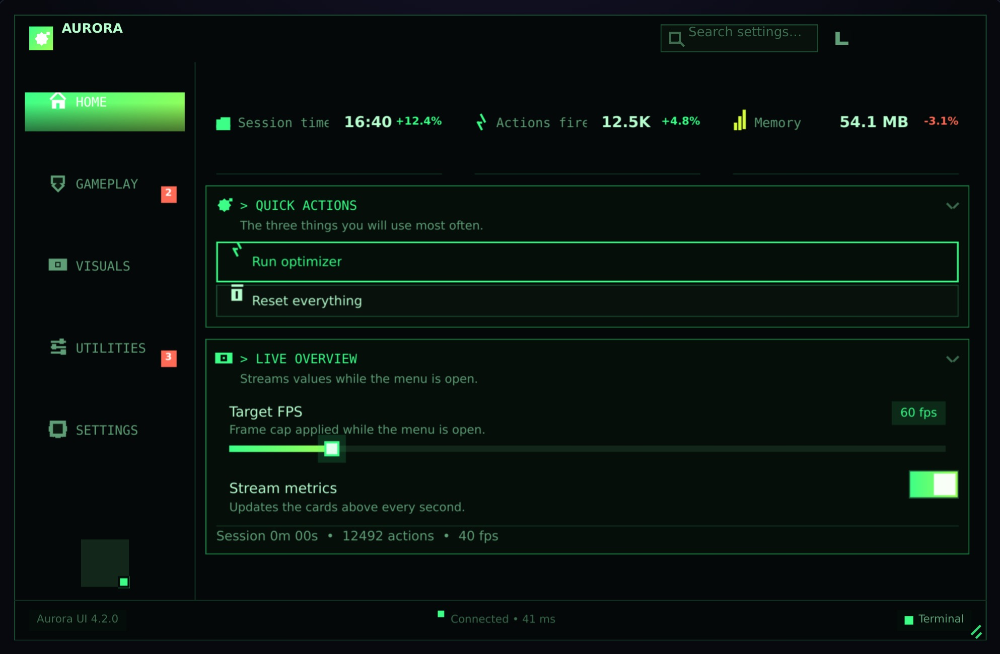 | 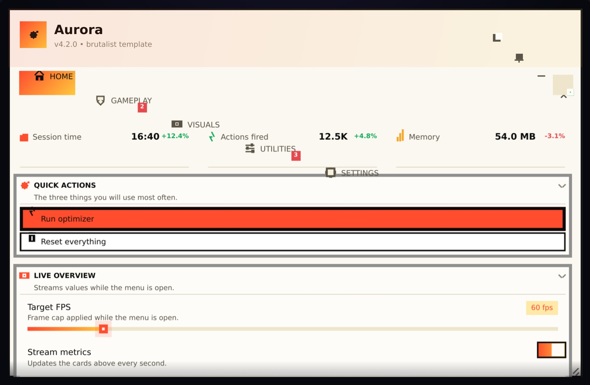 | 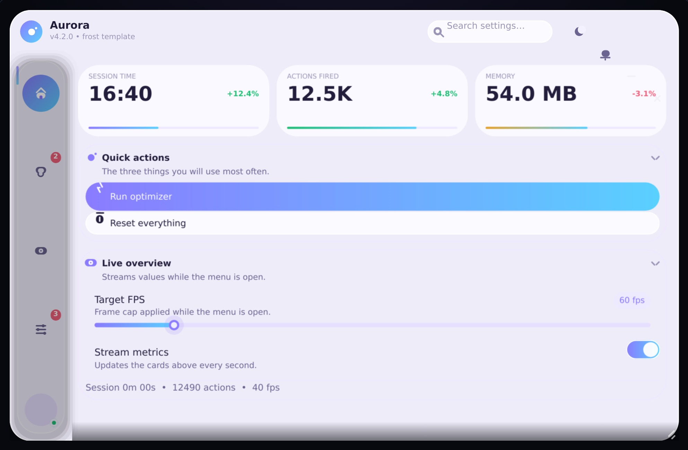 |
| **Terminal** · `terminal`<br>Phosphor green, monospace, square and dense | **Brutalist** · `brutalist`<br>Paper white, 2 px black borders, zero radius | **Frost** · `frost`<br>Frosted pastel glass, very round |
| 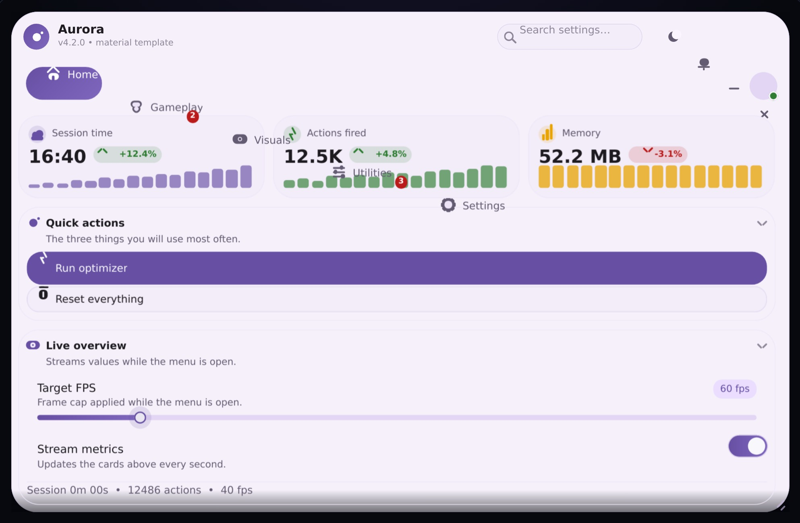 | 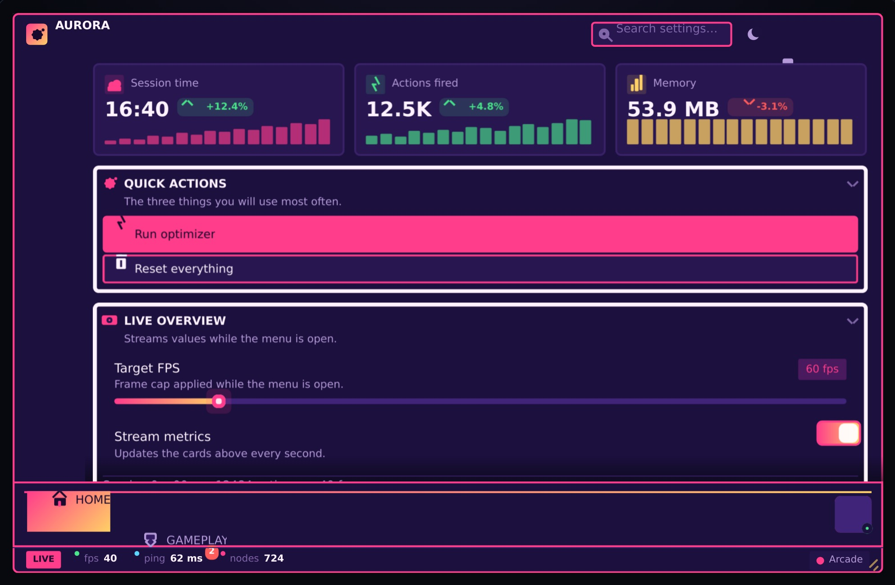 | 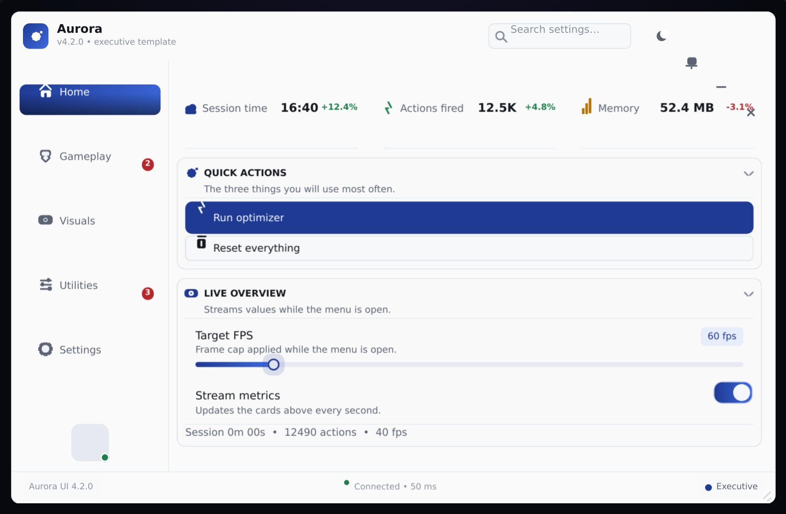 |
| **Material You** · `material`<br>Soft tonal surfaces, pill controls | **Arcade** · `arcade`<br>Retro cabinet: deep purple, hot pink | **Executive** · `executive`<br>Quiet corporate greys, navy accent |
| 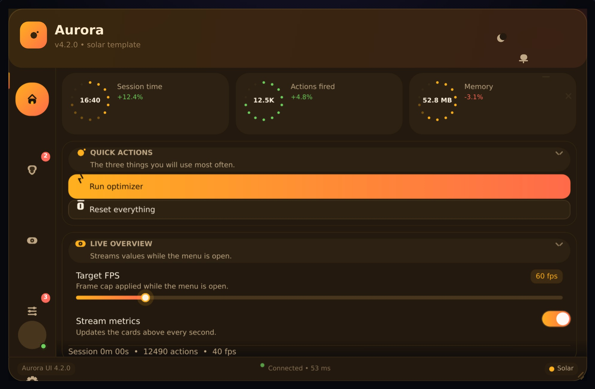 | **What changes between them** | |
| **Solar** · `solar`<br>Warm sand and amber, sunlit gradients | **Everything.** In 4.0 a style is a palette **plus a layout blueprint plus a motion profile** — where the navigation lives, how numbers are presented, how a section is drawn, and how the whole thing enters and moves. The table below is the blueprint matrix. | |

### The blueprint matrix

Each row is what you get from `CreateWindow({ Style = "…" })`. No two rows are
the same, and none of this is a recolour.

| Style | Navigation | Header | Numbers | Sections | Footer | Decor | Motion |
| --- | --- | --- | --- | --- | --- | --- | --- |
| **Midnight** | icon rail | bar | 3 cards + sparklines | glass panels | status | glow | rise · glow · shimmer |
| **Daylight** | top tab bar | hero | hero headline + fill bar | free cards | — | — | pop · lift |
| **Neon Grid** | icon rail | strip | capsules | outline panels | ticker | grid | glitch · glow · scan |
| **Terminal** | labelled sidebar | strip | table rows | console panes | status | scanlines | type · blink |
| **Brutalist** | top tab bar | hero | table rows | hairline list | — | — | snap · press |
| **Frost** | floating rail | bar | hero headline | free cards | — | dots | fade · lift · pulse |
| **Material You** | top tab bar | bar | 3 cards + sparklines | free cards | — | — | pop · lift |
| **Arcade** | bottom dock | strip | 3 cards + sparklines | free cards | ticker | grid | bounce · press · blink |
| **Executive** | labelled sidebar | bar | table rows | hairline list | status | — | fade |
| **Solar** | icon rail | hero | ring dials | pill accordion | status | glow | rise · lift · pulse |

---

## How a style is defined

One table in [`src/UI/UILibrary/Styles.luau`](src/UI/UILibrary/Styles.luau):

```lua
{
    Slug = "terminal",
    Name = "Terminal",
    Tagline = "Phosphor green on black, monospace, squared-off and dense",
    Mood = "Dark · Mono · Flat",

    Palette = makePalette("Terminal", "#3DFF88", {
        backdrop = "#020603", panel = "#05090A", surface = "#08110C",
        text = "#B8FFD0", textMuted = "#5F9E76",
        accent = "#3DFF88", accent2 = "#9BFF57", accentSoft = "#0D2A19",
        stroke = "#1C4B31", strokeBright = "#3DFF88",
    }),

    Metrics = {
        Card = "flat", Button = "outline",
        RadiusScale = 0, MaxRadius = 0,      -- perfectly square
        TabShape = "square", HeaderCase = "upper",
        BorderAlphaScale = 0.5, Shadow = 0, Density = 0.94, Mono = true,
    },

    -- what the window is made of
    Layout = {
        Nav = "sidebar",      -- rail | sidebar | tabs | float | dock
        NavWidth = 168,
        Header = "strip",     -- bar | strip | hero
        Stats = "rows",       -- cards | rows | chips | headline | dials
        Sections = "console", -- panels | cards | list | console | accordion
        Footer = "status",    -- status | ticker | none
        Decor = "scan",       -- none | glow | grid | scan | dots
    },

    -- how it arrives, reacts and idles
    Motion = {
        Entry = "type", Hover = "none", Idle = "blink",
        Duration = 0.20, Stagger = 0.02, Easing = "Linear",
    },
}
```

### Layout reference

| Key | Values | What it does |
| --- | --- | --- |
| `Nav` | `rail` · `sidebar` · `tabs` · `float` · `dock` | 74 px icon column · wide labelled column · top tab bar · detached floating panel · bottom dock |
| `NavWidth` | number | width of the labelled sidebar / floating rail |
| `Header` | `bar` · `strip` · `hero` | 58 px bar · 44 px half bar with an uppercase title · 92 px header with a big title and an accent wash |
| `Stats` | `cards` · `rows` · `chips` · `headline` · `dials` | sparkline cards · table rows · compact pills · one hero number with a fill bar · 14-segment ring gauges |
| `Sections` | `panels` · `cards` · `list` · `console` · `accordion` | tinted card · no shell at all · flat panel with a hairline rule · monospace pane with an accent rule · pill header |
| `Footer` | `status` · `ticker` · `none` | version pill + live dot + theme chip · LIVE pill + fps/ping/nodes legend · no footer |
| `Decor` | `none` · `glow` · `grid` · `scan` · `dots` | backdrop overlay drawn by the preview engine |

### Motion reference

| Key | Values | What it does |
| --- | --- | --- |
| `Entry` | `rise` · `pop` · `fade` · `glitch` · `type` · `snap` · `bounce` | how each control arrives |
| `Hover` | `glow` · `lift` · `press` · `none` | pointer feedback (`Anim.Hover`) |
| `Idle` | `shimmer` · `scan` · `blink` · `pulse` · `none` | what moves when nobody is touching it |
| `Duration` / `Stagger` / `Easing` | seconds / seconds / `Linear`…`Elastic` | timing, per-sibling delay, curve |

`Anim.luau` runs the profile through `TweenService` in game;
`tools/engine.js` replays the same profile in CSS in the preview. One profile,
two renderers.

### Metrics reference

| Key | Values | What it does |
| --- | --- | --- |
| `Card` | `glass` · `elevated` · `outline` · `flat` · `brutal` | section card treatment |
| `Button` | `gradient` · `solid` · `outline` · `brutal` | primary/block button treatment |
| `TabShape` | `rounded` · `square` · `pill` | rail button shape |
| `HeaderCase` | `normal` · `upper` | section titles and tab labels |
| `RadiusScale` / `MaxRadius` | number / number | multiply, then clamp **every** corner in the kit |
| `BorderScale` / `BorderAlphaScale` | number / number | compress or thicken every `UIStroke` |
| `Shadow` | number | multiplies drop-shadow strength |
| `Density` | number | row height multiplier |
| `Glow` / `Mono` | boolean | accent halo on active elements / monospace headings |

`Layout` and `Motion` are optional — leave them out and the style falls back to
the Midnight blueprint (`rail` / `bar` / `cards` / `panels` / `status`) with a
`rise` entrance.

Styles are registered with the theme system on load, so `window:SetTheme("Solar")`
still works for live palette swaps; geometry is baked when the window is built, so
rebuild the window to change the *shape*.

### Adding your own

Drop a table into `Styles.All` (palette + metrics), then:

```bash
python3 tools/bundle.py && node tools/render.js --all
```

It appears in the preview chips, the docs and the README generator with no other
edits.

---

## The preview is interactive

`docs/index.html` (and `docs/real-ui.html`) is not a screenshot: it is the
instance tree the Luau built, laid out in the DOM, with its behaviour wired
back up by `tools/engine.js`.

| You do this | …and this happens |
| --- | --- |
| click a tab | the page switches and the rail indicator slides |
| click a switch | the knob travels, the track takes the accent |
| drag a slider | knob, fill and the value pill move together |
| click a section header | the body collapses, the chevron turns |
| click a button | it presses and raises a toast in the style's palette |
| type in the search box | rows on the active page filter live |
| click a colour swatch | it cycles and the hex label updates |
| drag the title bar | the window shoves and springs back |
| close / minimise | it hides, with a "Reopen preview" button |
| click a dropdown row | a real popover opens; pick an option and the value changes |
| click the key pill | it listens for a key and rebinds itself |
| hover a tab or control | a tooltip names it |
| the moon button | swaps to the next template |

Under every window the gallery prints the template's **blueprint**
(`nav rail · header bar · stats cards · sections panels · footer status ·
decor glow · motion rise · glow · shimmer`), read from the same table the Luau
uses — so what you see is the layout definition, not a caption.

Every style also brings its own **motion**: the entrance stagger, the hover
feedback and the idle loops come from the style's `Motion` profile, so Neon
Grid glitches in while Executive simply fades.

## The preview

There is exactly **one** preview page — [`docs/index.html`](docs/index.html), served at
<https://lorenzz20105-del.github.io/aurora-ui-templates/> — and it is generated, not drawn:

```bash
python3 tools/bundle.py                      # flatten src/ → dist/AuroraUI.luau
LUAU=/path/to/luau python3 tools/dump-all.py  # build all 10 windows headlessly
node tools/render.js --all                    # → docs/index.html (the gallery)
node tools/style-shots.js                     # → docs/styles/*.jpg for this README
```

1. `tools/dump-all.py` walks the registry and runs the **real** library + demo once
   per style inside `tools/robloxmock.luau` (a headless stub of `Instance.new`,
   `TweenService`, `RunService`, `UDim2`, `UIScale`, attributes …).
2. `tools/dump-tree.luau` serialises every GUI instance with its properties and its
   `UIListLayout` / `UIGridLayout` / `UIPadding` / `UICorner` / `UIStroke` /
   `UIGradient` / `UIFlexItem` children → `docs/styles/<slug>.json`
   (7,293 instances across the ten templates).
3. `tools/engine.js` re-implements the parts of Roblox's layout engine that matter
   (automatic sizing, list/grid layout, padding, anchors, rotation, gradients,
   strokes, text metrics) and paints the tree into one self-contained HTML file —
   no network, no images, no webfonts. Tab switching is wired back to the dumped
   geometry, so the rail, tab bar and sidebar all work.

Because the renderer is honest, it doubles as a regression test: it is what caught
a 1 px sidebar, a footer overlapping the page body, buttons whose labels were laid
out off-screen, section descriptions drifting into the header row, drop shadows on
auto-sized cards collapsing to a sliver, and `Util.TrimNumber` turning `60` into `6`.

---

## Install

### Option A — Rojo (recommended)

```bash
git clone <this repo> aurora-ui && cd aurora-ui
rojo serve            # then connect from Studio
```

`default.project.json` maps `ReplicatedStorage.UI` ← `src/UI` and
`StarterPlayerScripts.Main` ← `src/Client/Main.client.luau`. Press **Right Shift**.

### Option B — single file (executors, mobile, Delta)

`dist/` holds the whole library flattened into one script — no `ModuleScripts`, no
`require`, no asset ids:

| File | Lines | What it does |
| --- | --- | --- |
| `dist/AuroraUI.luau` | 6,994 | Library only — returns the `Aurora` table (includes `Styles`) |
| `dist/AuroraDemo.luau` | 7,645 | Library **+** the 5-tab demo — builds the menu on execution |
| `dist/AuroraPreview.luau` | 7,631 | Library **+** `Preview` — mounts the live component preview |

To choose a template in a single-file build, edit the one constant at the top of
the demo:

```lua
local STYLE = "Midnight"   -- midnight · daylight · neon · terminal · brutalist
                           -- frost · material · arcade · executive · solar
```

---

## Window API

```lua
local window = UI.CreateWindow({
    Title = "Aurora",
    Subtitle = "v" .. UI.Version,
    Icon = "sparkle",
    Style = "Midnight",       -- template: palette + geometry
    Theme = "Daylight",       -- optional palette-only override
    Scale = 1,                -- 0.5–1.6, auto-fits the viewport
    Search = true,            -- title-bar search
    Footer = true,
    MobileButton = true,      -- on-screen toggle for touch devices
    Keybind = Enum.KeyCode.RightShift,
    Status = "Connected  •  62 ms",
})
```

| Method | Purpose |
| --- | --- |
| `window:CreateTab{ Name, Icon, Badge }` | add a tab (rail button, labelled row or tab-bar pill depending on the style) |
| `window:SelectTab(tab)` | switch pages |
| `window:Notify{ Title, Body, Type, Icon, Duration }` | toast (max 4, oldest is retired) |
| `window:SetTheme(name)` / `window:SetAccent(color)` | live palette change |
| `window:SetScale(n)` / `window:GetScale()` | user scaling |
| `window:SetSubtitle(text)` / `window:ClearNotifications()` | small runtime helpers |
| `window:Modal{ Title, Body, Actions }` | confirm dialog |
| `tab:CreateSection{ Name, Icon, Description, Badge }` | card that groups rows |
| `tab:AddStats{ … }` / `tab:AddGrid{ Columns }` / `tab:AddSpacer(h)` | layout helpers |
| `section:AddToggle/AddSlider/AddDropdown/AddTextBox/AddKeybind/AddColorPicker/AddButton` | controls |
| `section:SetCollapsed(bool)` / `ToggleCollapsed()` / `SetVisible(bool)` | card state |

---

## What is in the box

| | |
| --- | --- |
| Source | 8,169 lines of Luau across 21 files |
| Templates | 10 styles, 4 palettes shipped, unlimited via `Styles.All` |
| Components | 14 widgets, 31 vector icons drawn from Frames (zero assets) |
| Layouts | icon rail, labelled sidebar, horizontal tab bar |
| Card treatments | glass, elevated, outline, flat, brutal |
| Tests | 5 headless suites: desktop, touch-only phone, zero viewport, preview, demo |
| Preview | one self-contained page, 10 windows, 7,293 captured instances |
| Runtime deps | none; build needs Luau CLI + Python 3 (+ Node for the preview) |

---

## Repository layout

```
dist/                        # generated by tools/bundle.py — commit it
├── AuroraUI.luau            # single-file library   (returns Aurora)
├── AuroraDemo.luau          # library + demo        (runs)
└── AuroraPreview.luau       # library + preview     (runs)

docs/
├── index.html               # THE preview: all ten templates, one page (GitHub Pages)
├── real-ui.html             # the same engine, single window (Midnight)
├── styles/                  # per-template dumps (.json) and shots (.jpg)
└── mock.html                # hand-authored design mock (legacy reference)

src/
├── Client/Main.client.luau  # demo: 5 tabs, live stats, every component
└── UI/UILibrary/
    ├── init.luau            # public API (CreateWindow, SetTheme, Format …)
    ├── Styles.luau          # ← the ten templates
    ├── Theme.luau           # palettes, type scale, spacing, layout constants
    ├── Anim.luau            # motion profiles: entry, hover, idle (TweenService)
    ├── Util.luau            # instance helpers, tweens, drag, theming, style metrics
    ├── Icons.luau           # 31 vector icons + asset override table
    ├── Preview.luau         # in-engine live preview module
    └── Components/          # Window, Tab, Section, Row, Button, Toggle, Slider,
                             # Dropdown, TextBox, Keybind, ColorPicker, StatCard,
                             # Notification, Tooltip

tools/
├── bundle.py                # flattens the module tree, cycle-checks requires
├── run-tests.sh             # the five suites
├── smoke.luau               # builds every component, round-trips setters
├── robloxmock.luau          # headless Roblox API mock (tests + dump)
├── dump.py / dump-all.py    # run the library headlessly → docs/**/*.json
├── dump-tree.luau           # serialises the instance tree
├── engine.css / engine.js   # the layout engine used by both preview pages
├── render.js                # dump + engine → docs/real-ui.html | docs/index.html
└── style-shots.js           # per-template screenshots (docs/styles/*.jpg)
```

---

## Testing

```bash
LUAU=/path/to/luau ./tools/run-tests.sh

▸ desktop                SMOKE OK — 31 icons, 3 tabs, all setters round-tripped
▸ touch-only phone       MOBILE PASS
▸ zero viewport          ZERO VIEWPORT PASS
▸ preview build          PREVIEW PASS — 4 tabs, log lines: 1
▸ demo build             DEMO PASS
✓ all suites passed
```

The preview has its own checks:

```bash
python3 tools/check-render.py          # structure of the dumps + the page
python3 tools/compare-dump.py a.json b.json   # structural drift, ignores live numbers
```

CI runs the suites, a `luau-compile` sweep, a check that `dist/` matches the
sources, and a `render` job that rebuilds all ten dumps and the preview from
scratch.

---

## Mobile & executors

- Every control is touch-friendly (44 px targets, no hover-only affordances) and
  the window auto-scales from 0.5× to 1.6× to fit the viewport.
- `MobileButton` adds an on-screen toggle; the keybind is optional.
- No `require` of uploaded assets, no `rbxassetid://`, no `HttpService` — the whole
  kit is Frames, UICorners, UIStrokes and TextLabels, which is why it survives
  constrained executors (Delta and friends) and phones.
- Single-file builds in `dist/` are the paste-and-run path.

---

## Contributing

See [CONTRIBUTING.md](CONTRIBUTING.md). New template? Add a `Styles.All` entry,
run `python3 tools/dump-all.py && node tools/render.js --all`, and the preview,
the README table and the screenshots pick it up.

## License

MIT — see [LICENSE](LICENSE).
